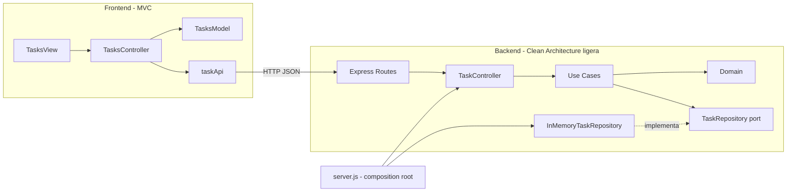

# Gestor de tareas - Refactorización por capas

Proyecto base del taller de arquitectura de software refactorizado para aplicar separación de responsabilidades, bajo acoplamiento y alta cohesión.

La solución quedó organizada con **Clean Architecture ligera en el backend** y **MVC en el frontend**. La persistencia sigue en memoria, pero ahora está detrás de un puerto de repositorio que permite cambiarla por JSON o SQLite sin tocar el dominio ni los casos de uso.

## Resultado

- Backend dividido en `domain`, `application`, `infrastructure` e `interfaces/http`.
- Frontend dividido en `api`, `models`, `views`, `controllers` y un punto de composición.
- Reglas de negocio sin dependencias de Express ni de HTTP.
- Repositorio intercambiable y sin fugas de estado interno.
- Manejo centralizado de errores y respuestas HTTP consistentes.
- 43 pruebas automatizadas: 30 en backend y 13 en frontend.
- Frontend servido por el backend en `http://localhost:3000`.

## Cómo ejecutar

Requisitos: Node.js 20.19+, 22.13+ o 24+ (la suite del frontend usa `jsdom`). El proyecto fue probado con Node.js 24.

```powershell
cd backend
npm install
npm start
```

Abrir `http://localhost:3000`. El backend expone la API y sirve el frontend estático.

Para desarrollo con recarga automática:

```powershell
cd backend
npm run dev
```

Variables de entorno opcionales:

| Variable | Valor por defecto | Descripción |
|---|---|---|
| `PORT` | `3000` | Puerto del servidor |
| `CORS_ORIGIN` | `*` | Origen permitido por CORS |
| `STATIC_DIR` | carpeta `frontend` de la raíz | Carpeta del frontend estático |

Ejemplo en PowerShell:

```powershell
$env:PORT=4000
npm start
```

## Cómo ejecutar las pruebas

```powershell
cd backend
npm test
```

```powershell
cd frontend
npm install
npm test
```

Las pruebas del backend usan `node:test` y `supertest`. Las del frontend usan `node:test` y `jsdom`.

## Qué cambió

### Problemas encontrados en el código base

| # | Problema | Evidencia en el código original | Corrección |
|---|---|---|---|
| 1 | Frontend monolítico: HTTP, estado, DOM, eventos, estilos y reglas de estado en un solo archivo | `frontend/src/app.js:1-99` | Separación en API, modelo, vista y controlador |
| 2 | La lógica de negocio conocía HTTP y creaba errores con `statusCode` | `backend/src/taskService.js:14-15,23-24,29-30` | Errores de dominio y middleware que traduce a HTTP |
| 3 | Modelo anémico, validaciones fuera de la entidad y estados duplicados | `backend/src/domain.js:1-9`, `taskService.js:1`, `frontend/src/app.js:40` | Entidad `Task` con invariantes y `TaskStatus` como única fuente de verdad |
| 4 | Repositorio con semilla, generación de IDs y creación de entidades; además filtraba objetos mutables | `backend/src/taskRepository.js:5-31` | Puerto de repositorio e implementación en memoria que devuelve copias |
| 5 | `server.js` mezclaba configuración, composición, rutas, errores y arranque | `backend/src/server.js:8-25` | `app.js` crea la app, `server.js` compone y arranca, `config.js` centraliza configuración |
| 6 | Sin pruebas ni documentación de arquitectura | `backend/package.json:7-10` | 43 pruebas, README y documentos de análisis/arquitectura |

El detalle completo está en [`docs/analisis.md`](docs/analisis.md).

### Backend

| Antes | Ahora |
|---|---|
| `src/domain.js` | `src/domain/Task.js`, `TaskStatus.js`, `errors.js` |
| `src/taskService.js` | `src/application/use-cases/*` |
| `src/taskRepository.js` | `src/application/ports/TaskRepository.js` y `src/infrastructure/InMemoryTaskRepository.js` |
| `src/taskController.js` | `src/interfaces/http/taskController.js` y `taskPresenter.js` |
| `src/taskRoutes.js` | `src/interfaces/http/taskRoutes.js` y `healthRoutes.js` |
| `src/server.js` | `src/app.js` (crear app), `src/server.js` (composición) y `src/config.js` |

Cambios concretos:

- `Task` valida el título, normaliza la descripción, conserva `createdAt` al rehidratar y actualiza `updatedAt` al cambiar de estado.
- Los estados válidos viven únicamente en `TaskStatus`.
- Los casos de uso `ListTasks`, `CreateTask`, `ChangeTaskStatus` y `GetTaskStatuses` no conocen Express ni códigos HTTP.
- `TaskRepository` es el contrato; `InMemoryTaskRepository` es una implementación sustituible.
- El repositorio entrega copias, por lo que modificar un resultado no altera los datos almacenados.
- `createApp()` permite probar la API sin abrir un puerto.
- El middleware de errores traduce `ValidationError` a `400`, `NotFoundError` a `404` y errores inesperados a `500` sin filtrar detalles internos.
- Se agregó `GET /api/tasks/statuses` para que el frontend no duplique la lista de estados.

### Frontend

| Antes | Ahora |
|---|---|
| `frontend/src/app.js` | `src/api/taskApi.js`, `src/models/tasksModel.js`, `src/views/tasksView.js`, `src/controllers/tasksController.js`, `src/app.js` |

Cambios concretos:

- `taskApi.js` solo transporta HTTP y lanza `ApiError`.
- `tasksModel.js` guarda el estado y devuelve copias; no toca el DOM.
- `tasksView.js` solo consulta y modifica el DOM, usando `textContent` en lugar de `innerHTML`.
- `tasksController.js` coordina eventos, API, modelo y vista.
- `app.js` es el punto de composición.
- La URL de la API es configurable y por defecto usa `/api`.
- Si el frontend se sirve desde otro origen, se puede definir `window.__TASK_API_URL__ = "http://localhost:3000/api"` antes de cargar `src/app.js` o editar `frontend/src/config.js`.
- Los estilos inline se movieron a clases CSS.
- Los estados se obtienen del backend, no están hardcodeados.
- Se agregaron pruebas de DOM, sanitización, modelo y controlador.

## API

| Método | Ruta | Descripción |
|---|---|---|
| `GET` | `/api/health` | Estado del servicio |
| `GET` | `/api/tasks` | Lista de tareas |
| `GET` | `/api/tasks/statuses` | Estados oficiales |
| `POST` | `/api/tasks` | Crea una tarea |
| `PATCH` | `/api/tasks/:id/status` | Cambia el estado de una tarea |

Crear una tarea:

```json
{
  "title": "Crear diagrama de arquitectura",
  "description": "Separar dominio, aplicación, infraestructura e interfaz"
}
```

Cambiar el estado:

```json
{
  "status": "finalizada"
}
```

Estados permitidos: `pendiente`, `en progreso`, `finalizada`.

Los errores mantienen la forma:

```json
{
  "error": "Mensaje descriptivo"
}
```

## Estructura del proyecto

```text
Guia5Arquitectura/
├─ backend/
│  ├─ src/
│  │  ├─ domain/
│  │  │  ├─ Task.js
│  │  │  ├─ TaskStatus.js
│  │  │  └─ errors.js
│  │  ├─ application/
│  │  │  ├─ ports/TaskRepository.js
│  │  │  └─ use-cases/
│  │  │     ├─ ListTasks.js
│  │  │     ├─ CreateTask.js
│  │  │     ├─ ChangeTaskStatus.js
│  │  │     └─ GetTaskStatuses.js
│  │  ├─ infrastructure/
│  │  │  ├─ InMemoryTaskRepository.js
│  │  │  └─ seed.js
│  │  ├─ interfaces/http/
│  │  │  ├─ taskController.js
│  │  │  ├─ taskRoutes.js
│  │  │  ├─ taskPresenter.js
│  │  │  ├─ errorHandler.js
│  │  │  └─ healthRoutes.js
│  │  ├─ config.js
│  │  ├─ app.js
│  │  └─ server.js
│  ├─ tests/
│  │  ├─ unit/
│  │  └─ integration/
│  └─ package.json
├─ frontend/
│  ├─ index.html
│  ├─ styles.css
│  ├─ src/
│  │  ├─ api/taskApi.js
│  │  ├─ models/tasksModel.js
│  │  ├─ views/tasksView.js
│  │  ├─ controllers/tasksController.js
│  │  ├─ config.js
│  │  └─ app.js
│  ├─ tests/
│  └─ package.json
├─ docs/
│  ├─ analisis.md
│  ├─ arquitectura.md
│  └─ pruebas.md
└─ README.md
```

## Arquitectura



Regla de dependencia:

```text
domain <- application <- interfaces/http
                       <- infrastructure
server.js -> composición de implementaciones concretas
```

- `domain` no importa Express, HTTP ni persistencia.
- `application` no usa `req`, `res` ni `statusCode`.
- `interfaces/http` adapta HTTP a los casos de uso.
- `infrastructure` implementa el puerto de repositorio.
- `server.js` es el único lugar que conoce las implementaciones concretas.

El diagrama y las decisiones detalladas están en [`docs/arquitectura.md`](docs/arquitectura.md).

## Verificación

Resultados de la ejecución local:

| Verificación | Resultado |
|---|---|
| Pruebas backend | 30 aprobadas |
| Pruebas frontend | 13 aprobadas |
| `GET /api/health` | `ok` |
| `GET /api/tasks` | 2 tareas semilla |
| `POST /api/tasks` | Tarea creada con ID 3 |
| `PATCH /api/tasks/3/status` | Estado actualizado a `finalizada` |
| `GET /` | `200`, frontend con módulo ES |

Comandos de verificación arquitectónica usados:

```powershell
# No debe haber Express ni req/res en dominio ni aplicación
Get-ChildItem -Recurse -File backend\src\domain,backend\src\application |
  Select-String -Pattern "\bexpress\b|\breq\.|\bres\."

# No debe haber statusCode en dominio ni aplicación
Get-ChildItem -Recurse -File backend\src\domain,backend\src\application |
  Select-String -Pattern "statusCode"

# El modelo no debe tocar DOM ni hacer fetch
Get-ChildItem -Recurse -File frontend\src\models |
  Select-String -Pattern "document|window|innerHTML|fetch"
```

Los tres comandos no devolvieron coincidencias. La evidencia completa está en [`docs/pruebas.md`](docs/pruebas.md).

## Decisiones de diseño

- **Clean Architecture ligera, no DDD completo:** el proyecto es un CRUD pequeño; se aplicaron las capas y la inversión de dependencias sin agregar complejidad innecesaria.
- **Persistencia en memoria:** se conserva el comportamiento del proyecto base. El puerto permite migrar a JSON o SQLite sin cambiar dominio ni casos de uso.
- **Contrato de API estable:** se mantuvieron las rutas y respuestas existentes; solo se agregó `GET /api/tasks/statuses`.
- **Frontend sin framework:** se usaron módulos ES y DOM nativo para no ampliar el alcance del taller.
- **Frontend servido por Express:** evita problemas de CORS y de módulos ES al abrir archivos con `file://`. También se puede servir por separado; en ese caso se configura la URL de la API.
- **JavaScript + JSDoc implícito:** no se migró a TypeScript para mantener el foco en la arquitectura.
- **Sin autenticación ni transiciones nuevas de estado:** quedan fuera del alcance del taller.

## Documentación adicional

- [`docs/analisis.md`](docs/analisis.md): violaciones encontradas, evidencia y correcciones.
- [`docs/arquitectura.md`](docs/arquitectura.md): diagramas, responsabilidades y reglas de dependencia.
- [`docs/pruebas.md`](docs/pruebas.md): casos de prueba y evidencia de verificación.
