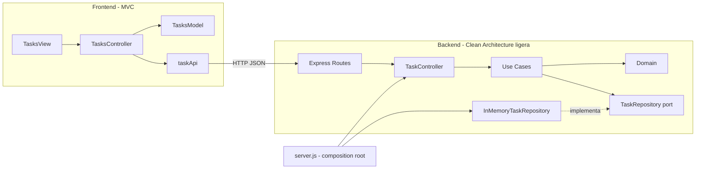
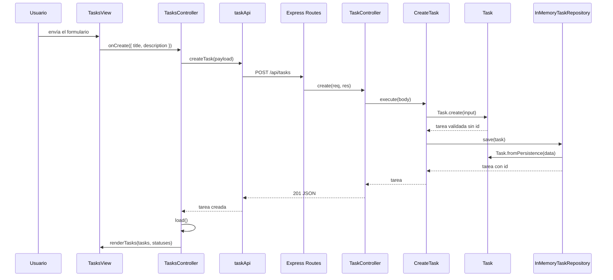

# Arquitectura de la solución

## Enfoque

- **Backend:** Clean Architecture ligera. Se separaron dominio, aplicación, infraestructura e interfaces HTTP, sin introducir DDD completo ni un contenedor de dependencias.
- **Frontend:** MVC con módulos ES. La vista solo manipula el DOM, el modelo solo guarda estado, el API client solo transporta HTTP y el controlador coordina.
- **Persistencia:** en memoria, detrás de un puerto que permite sustituirla.

## Diagrama de dependencias



Regla de dependencia:

```text
domain <- application <- interfaces/http
                       <- infrastructure
server.js -> implementaciones concretas
```

El dominio no conoce Express, HTTP ni persistencia. La aplicación no conoce `req`, `res` ni `statusCode`. Las implementaciones concretas dependen de las abstracciones, no al contrario.

## Diagrama de paquetes

```text
backend/src/
├─ domain/
│  ├─ Task.js
│  ├─ TaskStatus.js
│  └─ errors.js
├─ application/
│  ├─ ports/
│  │  └─ TaskRepository.js
│  └─ use-cases/
│     ├─ ListTasks.js
│     ├─ CreateTask.js
│     ├─ ChangeTaskStatus.js
│     └─ GetTaskStatuses.js
├─ infrastructure/
│  ├─ InMemoryTaskRepository.js
│  └─ seed.js
├─ interfaces/http/
│  ├─ taskController.js
│  ├─ taskRoutes.js
│  ├─ taskPresenter.js
│  ├─ errorHandler.js
│  └─ healthRoutes.js
├─ config.js
├─ app.js
└─ server.js
```

```text
frontend/src/
├─ api/
│  └─ taskApi.js
├─ models/
│  └─ tasksModel.js
├─ views/
│  └─ tasksView.js
├─ controllers/
│  └─ tasksController.js
├─ config.js
└─ app.js
```

## Responsabilidades

### Backend

| Capa | Responsabilidad | No debe hacer |
|---|---|---|
| `domain` | Entidad `Task`, estados válidos y errores de negocio | Importar Express, HTTP o persistencia |
| `application` | Casos de uso y puerto de repositorio | Conocer `req`, `res` o códigos HTTP |
| `infrastructure` | Implementar el repositorio en memoria y la semilla | Contener reglas de negocio |
| `interfaces/http` | Adaptar HTTP a casos de uso, presentar respuestas y traducir errores | Acceder directamente al repositorio |
| `app.js` | Crear la app Express y registrar middlewares/rutas | Abrir el puerto |
| `server.js` | Componer dependencias y arrancar el servidor | Contener reglas de negocio |
| `config.js` | Leer variables de entorno y valores por defecto | Conocer controladores |

### Frontend

| Componente | Responsabilidad | No debe hacer |
|---|---|---|
| `taskApi.js` | Transporte HTTP y errores de red | Tocar el DOM ni mantener estado de la vista |
| `tasksModel.js` | Guardar tareas y estados, devolver copias | Hacer `fetch` ni consultar el DOM |
| `tasksView.js` | Crear y actualizar elementos del DOM | Llamar a la API ni decidir reglas de negocio |
| `tasksController.js` | Coordinar eventos, API, modelo y vista | Renderizar HTML directamente |
| `app.js` | Componer las piezas | Implementar lógica de negocio |

## Flujo: crear una tarea



## Flujo: cambiar estado

1. La vista captura el clic y el valor del `select`.
2. El controlador llama a `taskApi.changeStatus(id, status)`.
3. La ruta `PATCH /api/tasks/:id/status` invoca `ChangeTaskStatus`.
4. El caso de uso valida el estado y busca la tarea en el puerto.
5. La entidad actualiza `status` y `updatedAt`.
6. El repositorio guarda una copia y devuelve otra copia.
7. El controlador recarga las tareas y la vista vuelve a renderizar.

## Manejo de errores

| Error | Origen | Respuesta HTTP |
|---|---|---|
| `ValidationError` | Título inválido o estado inválido | `400` con mensaje de negocio |
| `NotFoundError` | ID de tarea inexistente | `404` |
| JSON mal formado | `express.json()` | `400` |
| Error inesperado | Cualquier capa | `500` con mensaje genérico y log en servidor |

## Decisiones

- No se agregó un contenedor de dependencias: la composición manual en `server.js` es suficiente y explícita.
- El puerto `TaskRepository` es una clase base con métodos que fallan si no se implementan; sirve como contrato documentado en JavaScript.
- El repositorio en memoria usa `Task.clone()` para que los consumidores no puedan mutar el almacenamiento.
- El frontend usa `textContent` para evitar XSS y no depende de `innerHTML`.
- La lista de estados se expone en `GET /api/tasks/statuses` para no duplicarla en el cliente.
- El frontend se sirve desde Express para evitar problemas de CORS y de módulos ES con `file://`.
